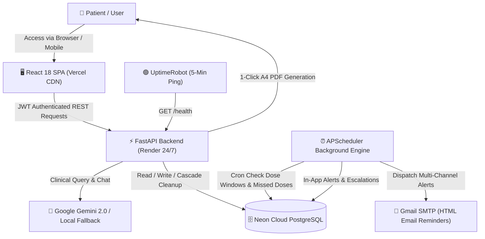

# 💊 MedAssist · Smart Medication Reminder & Clinical Adherence Agent

[](https://fastapi.tiangolo.com)
[](https://react.dev)
[](https://vitejs.dev)
[](https://neon.tech)
[](https://github.com/agronholm/apscheduler)
[](https://pytest.org)
[](https://medication-reminder-agent-snw7.vercel.app)
[](https://medication-reminder-backend-5yk5.onrender.com)

> An enterprise-grade digital health application designed to combat patient medication non-adherence. Features proactive multi-channel reminders, background cron evaluation, automated inventory depletion tracking, clinical consistency heatmaps, 1-click doctor summary PDF exports, and AI-powered drug interaction analysis.

---

## 🌐 Live Production Deployments

| Component | Status | Production URL |
| :--- | :---: | :--- |
| **Frontend Web Portal** |  | [medication-reminder-agent-snw7.vercel.app](https://medication-reminder-agent-snw7.vercel.app) |
| **Backend REST API** |  | [medication-reminder-backend-5yk5.onrender.com](https://medication-reminder-backend-5yk5.onrender.com) |
| **Interactive API Docs** |  | [medication-reminder-backend-5yk5.onrender.com/docs](https://medication-reminder-backend-5yk5.onrender.com/docs) |
| **Health Check & DB Status** |  | [medication-reminder-backend-5yk5.onrender.com/health](https://medication-reminder-backend-5yk5.onrender.com/health) |

---

## 🏗️ System Architecture



---

## ✨ Key Features & Engineering Highlights

### 1. 🔐 Enterprise Dual-Token Authentication & Security
- **Dual-Token Architecture:** Issues short-lived access tokens (configurable) paired with rotating refresh tokens stored hashed with **SHA-256** in PostgreSQL.
- **Replay Attack Defense:** Refresh tokens are revoked upon reuse, mitigating stolen token replay attacks.
- **1-Click Password Recovery:** Email-based tokenized password recovery with expiration validation and automatic secure redirect.
- **Protection:** Includes rate-limiting HTTP middleware, bcrypt password hashing, and configurable CORS policies.

### 2. 💊 Smart Scheduling & Inventory Management
- **Multi-Dose Windows:** Schedule multiple dose times per day (e.g., `08:00`, `14:00`, `20:00`) with custom weekday filters (`Mon-Sun`).
- **Inventory Depletion:** Marking a dose as taken automatically decrements stock counts in real-time.
- **Low-Stock Alerts:** Automatically triggers low-stock warnings when remaining quantity falls below the threshold.

### 3. ⏰ Asynchronous Background Task Scheduling
- Powered by **APScheduler** running background cron workers.
- Evaluates real-time patient dose windows, detects missed confirmations, calculates adherence scores, and escalates missed dose notifications automatically.

### 4. 📊 Clinical Adherence Analytics & 1-Click Doctor's Report (PDF)
- **Interactive Heatmap:** 7, 30, and 90-day GitHub-style consistency heatmaps showing daily compliance.
- **Trend Charts:** Visual Taken vs. Missed bar charts powered by Recharts.
- **CSV Data Export:** Instant download of patient medication audit logs.
- **🩺 Clinical Doctor's Report (PDF):** A 1-click clinical medical summary formatted for **A4 printing/saving as PDF**. Includes patient ID, active prescriptions, adherence score badge, AI clinical notes, and a physician signature section.

### 5. 🤖 AI Clinical Assistant & Drug-to-Drug Interaction Checker
- **Google Gemini 2.0 Integration:** Provides personalized schedule explanations, missed dose recommendations, and adherence insights.
- **Offline Deterministic Fallback:** Features a built-in clinical rule engine that functions seamlessly even when offline or without an API key.
- **Drug-Drug Interaction Checker:** Cross-references active medications against clinical contraindication databases.

---

## 📂 Project Directory Structure

```text
MedicationReminderAgent/
├── main.py                   # FastAPI application, route handlers, middleware & CORS
├── models.py                 # SQLAlchemy ORM models (User, Medication, Notification, Tokens)
├── schemas.py                # Pydantic validation schemas & request/response contracts
├── security.py               # JWT dual-token generation, bcrypt hashing & OAuth2 scheme
├── database.py               # PostgreSQL engine initialization with auto pool pre-ping
├── scheduler.py              # APScheduler background workers & reminder evaluation
├── notification_service.py   # Multi-channel notification dispatch (SMTP HTML, Webhooks, Telegram)
├── ai_service.py             # Gemini LLM integration & offline clinical rules engine
├── Dockerfile                # Production multi-stage Docker container specification
├── docker-compose.yml        # Multi-container orchestration (FastAPI + PostgreSQL)
├── render.yaml               # Cloud deployment blueprint
├── requirements.txt          # Pinned production Python dependencies
├── .python-version           # Pinned stable Python runtime (3.11.9)
├── tests/
│   └── test_api.py           # Automated test suite (23 pytest test cases)
└── frontend/                 # Modern React 18 SPA
    ├── src/
    │   ├── api.js            # Axios/Fetch API client with silent token renewal
    │   ├── App.jsx           # Master route router, global context & layout
    │   ├── App.css           # Custom theme design system & dark mode tokens
    │   └── pages/
    │       ├── Dashboard.jsx     # Patient overview, quick actions & dose tracker
    │       ├── Medications.jsx   # Prescription management & inventory refilling
    │       ├── Reminders.jsx     # Active dose timetable & confirmation cards
    │       ├── Analytics.jsx     # Heatmap, trend graphs & Doctor's Report PDF
    │       ├── AIInsights.jsx    # LLM chat assistant & interaction checker
    │       ├── Notifications.jsx # Activity center with mark-all-read & filters
    │       ├── Profile.jsx       # Account settings & password update
    │       └── PasswordReset.jsx # 1-Click email password reset flow
    ├── vercel.json           # SPA rewrite configuration for client-side routing
    ├── package.json          # Frontend dependencies & scripts
    └── vite.config.js        # Vite bundler configuration
```

---

## 🛠️ Technology Stack

| Layer | Technologies |
| :--- | :--- |
| **Frontend** | React 18, Vite, React Router 6, Recharts, CSS Variables (Dark/Light mode) |
| **Backend API** | Python 3.11, FastAPI, Pydantic v2, Starlette, Uvicorn |
| **Database & ORM** | PostgreSQL (Neon Cloud / Supabase), SQLAlchemy 2.0, Psycopg 3 |
| **Background Tasks** | APScheduler (Advanced Python Scheduler) |
| **Authentication** | Dual-Token JWT (Access + Rotating Refresh), Passlib, Bcrypt |
| **Notifications** | Python `smtplib`, MIME EmailMessage (HTML templates), Webhooks |
| **AI / LLM** | Google Gemini 2.0 Flash REST API + Offline Clinical Expert System |
| **Infrastructure** | Docker, Render (Web Service), Neon (Cloud PostgreSQL), Vercel (Edge CDN), UptimeRobot (24/7 Monitor) |
| **Testing** | Pytest, FastAPI TestClient, Pytest-Cov |

---

## 🚀 Local Development Setup

### 1. Clone the Repository
```bash
git clone https://github.com/maheshgou12/MedicationReminderAgent.git
cd MedicationReminderAgent
```

### 2. Backend Setup
```powershell
# Create & activate virtual environment
python -m venv .venv
.\.venv\Scripts\Activate.ps1

# Install dependencies
pip install -r requirements.txt

# Configure environment variables
cp .env.example .env

# Run FastAPI server (accessible across local network)
uvicorn main:app --host 0.0.0.0 --port 8000 --reload
```
> API available at: `http://localhost:8000` | Swagger docs: `http://localhost:8000/docs`

### 3. Frontend Setup
```powershell
cd frontend

# Install packages
npm install

# Run Vite development server
npm run dev -- --host 0.0.0.0 --port 5173
```
> Frontend available at: `http://localhost:5173`

---

## 🧪 Testing & Quality Assurance

The codebase includes comprehensive automated test coverage covering user registration, dual-token authorization, medication scheduling, cascade deletions, notifications, and AI fallback rules:

```powershell
# Run backend test suite
.venv\Scripts\python -m pytest tests/ -v

# Run frontend build verification & linter
cd frontend
npm run lint
npm run build
```

**Results:**
- `23 passed in 15.7s` (100% test pass rate)
- `0 lint errors` across all React JSX and API files
- Vite production build minified cleanly in `<350ms`

---

## 📄 License
This project is licensed under the [MIT License](LICENSE).
